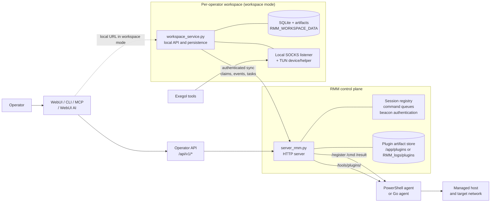
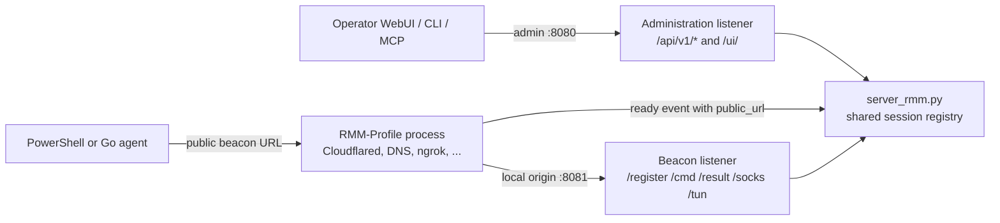
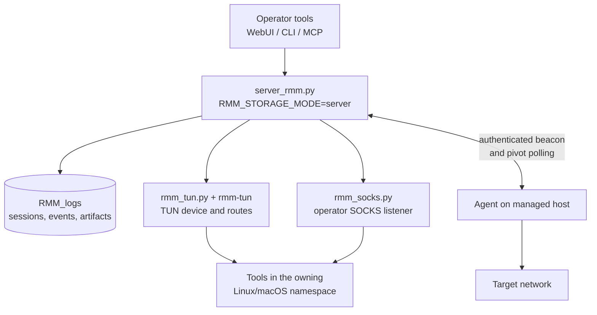
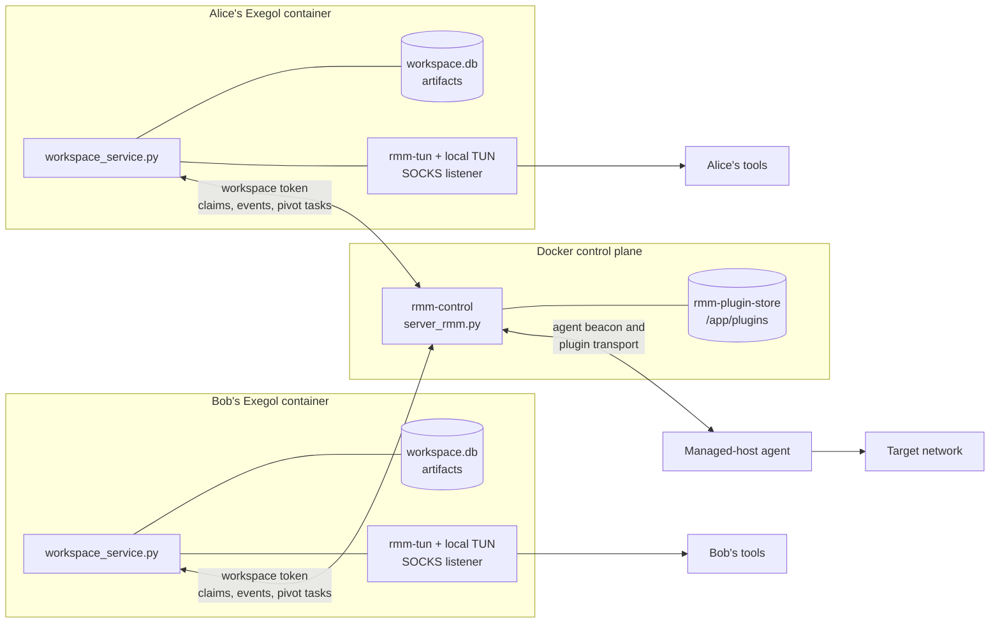
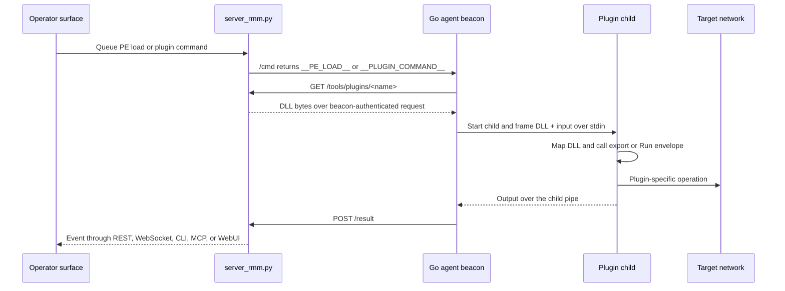
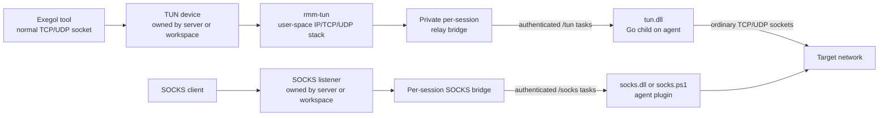

# Minimal-RMM architecture

This is the canonical description of the current runtime architecture. It
covers both the single-server deployment and the multi-operator deployment
with one workspace service per Exegol container. Procedures and detailed
protocol notes remain in the linked feature pages.

## System map

Minimal-RMM has four boundaries:

1. **Operator surface** — WebUI, CLI, MCP, and the WebUI AI loop send actions
   through the operator API.
2. **Control plane** — `server_rmm.py` authenticates agents and operators,
   owns session state and command queues, and relays agent traffic.
3. **Workspace data plane** — in workspace mode, one
   `workspace_service.py` instance per operator owns durable operator data and
   local network pivots.
4. **Agent runtime** — the PowerShell or Go agent runs on the managed host.
   The Go agent loads optional PE plugins in child processes; the target agent
   does not create a TUN device.

The workspace service is optional. In `RMM_STORAGE_MODE=server`, the central
server owns durable `RMM_logs` data, the operator-facing SOCKS listener, and
the TUN helper. In `RMM_STORAGE_MODE=workspace`, the central server remains
the agent transport and ownership broker while the workspace service owns the
operator's durable data and local pivot sockets.

See [workspace deployment](workspace-deployment.md) for container setup and
[server startup](server-startup.md) for the local wrapper and Docker entrypoint.

## Administration, beacon, and profile boundaries

The control plane binds the operator API and agent beacon to separate listener
roles. An RMM-Profile connects only to the beacon listener and publishes the
URL that generated agents should use:

The server does not parse Cloudflared, DNS, or ngrok output. It starts the
selected profile and consumes the generic `minimal-rmm-profile-v1` ready and
error events. Profile bundles are trusted server-side executables mounted from
`RMM_PROFILES_DIR`; they are maintained in the separate
[`Minimal-RMM-profiles`](https://github.com/CyrilleFranchet/Minimal-RMM-profiles)
repository. See [RMM-Profiles](rmm-profiles.md).

## Deployment topologies

### Single server

This is the simplest development and lab topology. The process that creates
the TUN device must have access to `/dev/net/tun` and the required network
administration capability. The target agent remains privilege-free.

### Central control plane plus workspaces

The central container deliberately does not receive `/dev/net/tun` or
`CAP_NET_ADMIN` in the Compose deployment. Each workspace that owns a TUN
device receives those permissions and must share its network namespace with
the tools that use the routes. A workspace can claim a session only through
its workspace credentials; a second workspace cannot use a claimed session.

## Control and data channels

| Channel | Direction | Purpose | Owner |
| --- | --- | --- | --- |
| `/register`, `/cmd`, `/result`, `/ping` | Agent ↔ control plane | Beacon registration, command polling, results, and health | `server_rmm.py` |
| `/tools/plugins/<name>` | Agent → control plane | Authenticated plugin artifact download | Runtime plugin store on the control plane |
| `/api/v1/*` | Operator ↔ server or workspace | Session control, profiles, assets, plugins, pivots, artifacts, AI, and history | Central server or local workspace facade |
| `/socks` | Agent ↔ pivot owner | Public SOCKS transport for TCP/UDP tasks | `rmm_socks.py` or workspace pivot bridge |
| `/tun` | Agent ↔ pivot owner | Dedicated TUN transport for TCP/UDP tasks | `rmm_tun.py` or workspace pivot bridge |
| Workspace endpoints | Workspace ↔ control plane | Claims, bounded events, and pivot task handoff | `workspace_service.py` + `server_rmm.py` |

The WebSocket endpoint remains available for compatible SOCKS clients, but the
current Go SOCKS and TUN plugins use authenticated HTTP polling. The normal
beacon continues polling while a persistent pivot child runs.

## Command and plugin flow

The main Go agent contains the generic fetch, child-process, and PE-loader
path. Plugin-specific command names, input validation, and output formats live
in the plugin artifact. The command namespace form sends a JSON envelope to the
plugin's `Run` export. See [dynamic plugin architecture](plugin-architecture.md)
and [Go agent plugins](go-agent-plugins.md).

The loader starts one child per one-shot command. The child exits after the
operation, so plugin state does not become state in the main beacon. SOCKS and
TUN are persistent exceptions: each has its own Go plugin package, DLL, child
process, lifecycle flag, and HTTP endpoint.

## Pivot data flow

The TUN device is a local operator-side interface. It is never created on the
managed host. The target-side plugin opens ordinary outbound TCP and UDP
sockets, which keeps the agent privilege-free. The current TUN implementation
does not carry raw packets or ICMP, so tools that require raw packet semantics
need a later transport.

## Storage ownership

| Data | Server mode | Workspace mode |
| --- | --- | --- |
| Active session metadata and ownership | Central server memory and `RMM_logs` | Central server memory and control-plane state |
| Command queues and agent transport | Central server | Central server |
| Plugin artifacts | `RMM_ASSETS_DIR` and runtime plugin directory | Workspace `data/assets/plugins/` plus central runtime cache |
| RMM-Profile bundles | `RMM_PROFILES_DIR` | Persistent profile volume on the control plane |
| Operator transcripts and events | `RMM_logs/` | Workspace SQLite database |
| Downloads, screenshots, keylogs | `RMM_logs/` | Workspace artifact directories |
| AI chat history | `RMM_logs/history/` | Workspace SQLite database |
| WebUI operator configuration | `RMM_UI_STATE_DB` (default `RMM_logs/ui-state.db`) | `ui_state` table in workspace SQLite database |
| rclone profiles | Server environment or asset store | Workspace asset store and optional profile file |
| SOCKS listener | Central server process | Workspace service |
| TUN device, routes, and helper | Central server process | Workspace service |

The control plane can see transient command and result data in both modes. The
workspace boundary controls where operator data is persisted and where local
network pivots are exposed. See [workspace deployment](workspace-deployment.md)
for the full ownership and authentication rules.

## Privilege boundaries

| Process | Runs where | Required privileges |
| --- | --- | --- |
| `server_rmm.py` | Control-plane host or `rmm-control` | HTTP bind and filesystem access; no TUN capability in Compose |
| `workspace_service.py` | Operator's Exegol container | Local storage; `CAP_NET_ADMIN` and `/dev/net/tun` when TUN is used |
| `rmm-tun` | Same namespace as the TUN device | Permission to open/configure the device and routes |
| PowerShell agent | Managed Windows host | Ordinary agent account for normal beacon and pivots |
| Go agent | Managed host | Ordinary agent account; no target-side TUN device |
| Go plugin child | Managed host | Same account as the Go agent; isolated lifetime |

The control plane never needs to join the operator's network namespace. The
workspace service makes outbound authenticated requests to the control plane,
which avoids an inbound connection from the central server into Exegol.

## What requires a rebuild or restart?

| Change | Server image rebuild | Server restart | Agent rebuild | Operational action |
| --- | --- | --- | --- | --- |
| Add a one-shot plugin DLL | No | No | No | Install the artifact in the runtime plugin store and queue it through `pe` |
| Add a plugin-owned command | No | No | No | Publish the updated artifact; invoke it with `--command` or an export |
| Replace a one-shot plugin | No | No | No | Atomically replace the artifact; new commands use the new bytes |
| Replace a running SOCKS/TUN artifact | No for the volume | No | No | Stop and restart that pivot so the child loads the replacement |
| Change `server-tun` or workspace helper code | Yes for Docker | Restart the process that owns the helper | No | Rebuild `rmm-tun`, update the image or local helper, then restart the owner |
| Add a new persistent lifecycle type | Usually | Yes after deployment | Usually | Extend the beacon lifecycle and operator surfaces together |
| Add a WebUI-only panel | No | Usually for server route changes | No | Update the static WebUI and any required API endpoint |

The generic plugin path is the extension point for new one-shot agent
capabilities. Persistent plugins remain deliberately explicit because they
need lifecycle state, cleanup, transport endpoints, and operator controls.

The external plugin repository builds and releases agent plugins. Minimal-RMM
builds only server-side helpers and serves the plugin artifacts installed in
the runtime store. See the [external plugin repository guide](plugin-repository.md).

## Repository map

| Area | Responsibility | Documentation |
| --- | --- | --- |
| `server_rmm.py` | HTTP control plane, operator API, plugin delivery, session state | [Root README](../README.md), [operator parity](mcp-parity.md) |
| `rmm_profile.py` | Generic profile discovery, process lifecycle, ready URL, and shutdown | [RMM-Profiles](rmm-profiles.md) |
| `rmm_asset_store.py` | Atomic URL asset downloads and enablement state | [Operator-managed assets](operator-assets.md) |
| `rmm_socks.py` | SOCKS5 listener and task bridge | [WebUI pivots](web-socks.md) |
| `rmm_tun.py` | TUN lifecycle, route setup, and private relay | [TUN pivot](tun-pivot.md) |
| `server-tun/` | Go helper embedding the user-space IP stack | [TUN pivot](tun-pivot.md) |
| `workspace_service.py` | Per-operator API facade, persistence, upstream sync | [Workspace deployment](workspace-deployment.md) |
| `workspace_pivot.py` | Workspace-local SOCKS/TUN ownership and transport handoff | [Workspace deployment](workspace-deployment.md) |
| `agent-go/` | Beacon, command execution, generic plugin child host | [Go agent](go-agent.md), [Go agent plugins](go-agent-plugins.md) |
| `Minimal-RMM-plugins` | Go and PowerShell plugin sources, tests, Windows builds, manifests, and release bundles | [External plugin repository](plugin-repository.md) |
| `agent-powershell/` | PowerShell beacon and script plugin host | [PowerShell generator](web-agent-generator.md), [pivot plugins](pivot-plugins.md) |
| `web/`, `rmm_cli.py`, `mcp_rmm_server.py` | Operator surfaces | [Operator parity](mcp-parity.md) |
| `Dockerfile`, `docker-compose.yml` | Control-plane image and optional workspace sidecar | [Workspace deployment](workspace-deployment.md) |

## Known limits

- The current TUN transport supports TCP and UDP socket flows. Raw packets and
  ICMP are outside the transport.
- The shipped TUN Go plugin targets Windows amd64 Go agents. Other agent types
  do not advertise that capability yet.
- Generic one-shot plugins are hot loaded from the runtime store. Arbitrary
  persistent plugin lifecycles are not self-describing yet.
- The plugin ABI is native PE/DLL. Managed .NET assemblies are outside the
  current loader scope.
- The central server remains able to observe transient operator and agent data;
  workspace mode changes durable storage and local pivot ownership.
