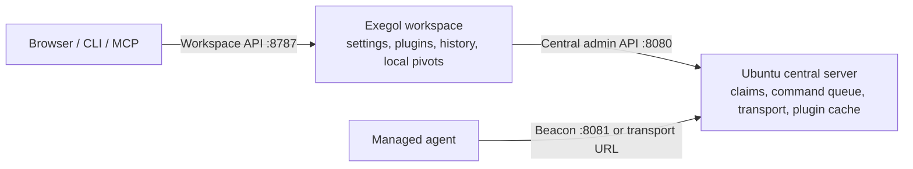

# Deployment guide

Use this page to choose and start a deployment. The other pages are references,
not additional steps to run on every machine. Work on branch **v2**;
Minimal-RMM `main` remains v1. The separate plugin repository uses `main`.

## Choose one topology

| Setup | Use it for | Processes |
| --- | --- | --- |
| **Ubuntu central server + one Exegol workspace per operator** | Your multi-operator setup | `server_rmm.py` on Ubuntu; `workspace_service.py` inside each Exegol environment |
| Compose central server + optional workspace sidecar | Container deployment on a Linux Docker host | Same processes, packaged in the shared image |
| Standalone server mode | A small shared lab without per-operator workspaces | `server_rmm.py` with `RMM_STORAGE_MODE=server` |

For the recommended first setup, follow steps 1–5 below. Do not also start the
Compose workspace sidecar for the same operator. Each operator needs a unique
workspace ID/token and its own persistent directory. Users sharing a workspace
also share its plugins and settings.



| Address or secret | Used by | Purpose |
| --- | --- | --- |
| Central administration URL, usually `:8080` | Workspace service and central administrator | Broker API; not the normal operator UI in workspace mode |
| Beacon URL, direct `:8081` or profile URL | Managed agents | Registration, polling, results, and plugin downloads |
| Workspace URL, usually `:8787` | Browser, CLI, standalone MCP | Operator's own API and UI |
| `RMM_API_TOKEN` on the central process | Central administrator | Global access |
| `RMM_BEACON_SECRET` | Central server and agents | Beacon authentication |
| `RMM_WORKSPACE_TOKEN` | Workspace service | Must match its ID in central `RMM_WORKSPACES` |
| `RMM_WORKSPACE_LOCAL_TOKEN` | Browser, CLI, standalone MCP | Authenticate to that workspace |

## 1. Prepare both checkouts

Use the current `v2` checkout on Ubuntu and inside Exegol. On each machine:

```bash
git switch v2
git pull --ff-only
python3 -m venv .venv
. .venv/bin/activate
python3 -m pip install -r requirements.txt
```

These examples use a POSIX shell and run from the repository root. They assume
Python 3.11+ and the OS's venv support are installed. No Go compiler is needed
for ordinary Python startup. See the optional-feature table below before using
TUN or generating a Go agent.

If Git reports divergent history, stop here and inspect it. Do not resolve a
rewritten history with an arbitrary merge. Keep a backup branch and reconcile
local work before updating. Do not delete `.env` or runtime directories.

## 2. Start the central server on Ubuntu

Copy the native configuration template to a private location:

```bash
mkdir -p "$HOME/.config/minimal-rmm"
cp deploy/central.env.example "$HOME/.config/minimal-rmm/central.env"
chmod 600 "$HOME/.config/minimal-rmm/central.env"
```

Edit that file before starting. Replace all secrets; put one entry per operator
in `RMM_WORKSPACES`. The template's address `10.254.50.203` is an example private
Ubuntu address: replace it with an address reachable by your workspaces and
agents. Its direct beacon URL must be reachable by the agents too.

```bash
set -a
. "$HOME/.config/minimal-rmm/central.env"
set +a
python3 server_rmm.py --bind 10.254.50.203 --beacon-bind 10.254.50.203
```

Replace both bind addresses with the actual interface address on Ubuntu.
This initial recipe assumes a trusted private network/VPN. Restrict the admin
port to operators/workspaces; use HTTPS termination for untrusted networks.
Python serves HTTP directly. Do not put the administration API behind the
agent-only transport profile.

`RMM_STORAGE_MODE=workspace` is required here. Direct Python defaults to
`server` mode; the Docker image and shipped Compose configuration default to
`workspace`. There is no `--storage-mode` argument.

Neither Python entry point loads `.env` automatically. The two `deploy/*.env.example`
files are shell-compatible templates. The root `.env.example` is for Compose;
its JSON syntax must not be assumed safe to load with shell `source`.

For systemd or another process manager, keep `WorkingDirectory` set to the
repository root, use the venv Python executable, and load the role-specific
environment file. Restart the central service after changing its workspace
registry or environment. The removed `run_server.py` wrapper is not needed.

## 3. Start one workspace inside Exegol

Inside the operator's Exegol container, using its own checkout:

```bash
mkdir -p "$HOME/.config/minimal-rmm"
cp deploy/workspace.env.example "$HOME/.config/minimal-rmm/workspace.env"
chmod 600 "$HOME/.config/minimal-rmm/workspace.env"
```

Edit the file: set `RMM_C2_URL` to Ubuntu's **admin** URL, match the workspace ID
and token to the central registry, and choose a separate local token. Set
`RMM_WORKSPACE_DATA` to a directory on an actual persistent mount, not merely
a writable container layer. Set a read-only GitHub plugin token if needed.

```bash
set -a
. "$HOME/.config/minimal-rmm/workspace.env"
set +a
python3 workspace_service.py
```

The workspace initiates its connections to Ubuntu; Ubuntu does not initiate a
connection to the workspace. For a central server on another machine, use its
reachable IP/DNS name. `rmm-control` is a Compose service name available only to
containers on that Docker network.

Open `http://127.0.0.1:8787/ui/` **from the workspace's network namespace** and
enter its local token. A browser on your host can use that address only when
it shares the namespace or a port has been forwarded. For a bridge-networked
Exegol container, configure localhost-only host port publication/forwarding to
container port 8787 and set `RMM_WORKSPACE_BIND=0.0.0.0` inside the container.
Retain the local token. Port publication belongs to the container launcher;
changing the service bind alone does not publish a host port.

For CLI or standalone MCP running inside that Exegol environment:

```bash
export RMM_SERVER_URL=http://127.0.0.1:8787
export RMM_API_TOKEN="$RMM_WORKSPACE_LOCAL_TOKEN"
python3 rmm_cli.py list
# For a stdio MCP client, use this executable command with the same environment:
# .venv/bin/python mcp_rmm_server.py
```

Here `RMM_API_TOKEN` is the client's token for the **local workspace**, not the
central administrator token. Do not share the administrator environment file
with operators. Setting up the standalone MCP endpoint is separate from the
WebUI AI loop; see [MCP parity](mcp-parity.md).

The WebUI AI loop runs centrally. Its optional Exegol MCP URL must be reachable
from the central server: `127.0.0.1:8000` refers to that server's network
namespace, not the operator's Exegol container. Configure an authenticated
endpoint reachable over the trusted network when those services are separate.

## 4. Claim sessions and install plugins

An empty workspace can mean that no sessions have been claimed. With the local
workspace environment loaded, list candidates and claim a chosen session:

```bash
curl --fail-with-body -H "Authorization: Bearer $RMM_WORKSPACE_LOCAL_TOKEN" \
  http://127.0.0.1:8787/api/v1/workspace/candidates
curl --fail-with-body -X POST \
  -H "Authorization: Bearer $RMM_WORKSPACE_LOCAL_TOKEN" \
  -H 'Content-Type: application/json' \
  -d '{"session_id":"REPLACE_WITH_SESSION_ID"}' \
  http://127.0.0.1:8787/api/v1/workspace/claims
```

Wait for the next workspace sync, then refresh the session list. Auto-claim is
**off by default**; enable it only when one workspace should claim all
unassigned sessions. A session already owned by another workspace is rejected.

In the **workspace UI**, open **Configuration → Compiled plugins from GitHub**.
Save the operator's repository/branch source, browse a release, and install the
required files. Or use `plugin sources`, `plugin releases`, and `plugin install`
through the local CLI. See [plugin source and release controls](plugin-releases-operator.md).
The workspace stores the binaries and synchronizes a workspace-specific cache
on Ubuntu. Manual copying into the shared central plugin directory is not
required for this flow.

Do not confuse saved plugin sources with beacon transport profiles. Sources
select compiled plugin releases; an RMM-Profile is a central transport process
such as Cloudflared. Embedding profiles are another separate concept: saved
model/classification settings in the workspace.

## 5. Add optional features deliberately

| Feature | Where to prepare it | Prerequisite |
| --- | --- | --- |
| Public beacon via Cloudflared or another RMM-Profile | Central Ubuntu server/container | Install the trusted profile bundle and provider executable; then set `RMM_PROFILE_AUTOSTART=1` and the selected profile |
| SOCKS | Workspace and managed agent | Install the matching SOCKS plugin through the workspace; tools use the workspace listener |
| TUN | Exegol workspace and managed agent | Install `tun.dll`; run `make tun-build` on the workspace host; Linux needs `ip`, `/dev/net/tun`, and `CAP_NET_ADMIN` |
| Go agent generation through API/WebUI | Central server | Go toolchain available centrally; the shipped runtime Docker image does not include Go |
| Document embeddings | Workspace and agent | Install the autonomous DLL, then configure/save the model profile; no ONNX compiler on either Python service |
| Rclone profiles | Workspace | Configure/upload profiles locally; the central service relays selected jobs |

The central broker needs no TUN privileges in workspace mode. TUN routes and
SOCKS listeners must share the namespace of the tools using them. The optional
workspace sidecar is not automatically in an existing Exegol tool namespace.

For a public beacon, follow [RMM-Profiles](rmm-profiles.md), then check
`python3 rmm_cli.py profile status` and use the returned beacon URL in agents.
Keep `RMM_C2_URL` pointed at the central admin API. The initial native template
disables profile autostart so missing optional bundles do not obscure setup.

## Compose alternative

Use the root `.env.example` only for Compose. Populate all required workspace
values even when initially starting only `rmm-control`, since Compose parses
service environment expressions. Do not overwrite an existing `.env` with the
example on updates. Start the central service:

```bash
# First installation only: copy .env.example to .env and edit all values.
docker compose up --build -d rmm-control
```

Choose **one** workspace placement:

- Existing Exegol container: follow step 3, using a reachable central URL.
- Example sidecar on the Docker host: `docker compose --profile workspace up --build -d`.
  This is a workspace service, not a full Exegol tools image.

The shipped Compose file publishes ports on host interfaces; restrict access
with host/cloud firewall rules or adjust the mappings for your network.
The sidecar binds inside its container and publishes host port 8787. Its TUN
configuration requires a Linux host with `/dev/net/tun`; the central service
has no such requirement. Container port numbers remain 8080/8081/8787 even if
you change the published host ports in `.env`.

The image includes Python dependencies, the native helper, and Linux `ip`.
It does not include the Go compiler, Cloudflared, or private profile/plugin
bundles. Install optional providers in a derived image when needed. Both
services use the same image, so an image build compiles the helper once;
ordinary process startup compiles nothing.

The example defines one workspace and one data volume. For multiple operators,
use separate workspace services/projects with distinct IDs, tokens, volumes,
and published ports. Do not scale copies sharing the same identity and volume.
See [workspace reference](workspace-deployment.md) for the protocol and volume
layout. Rclone configuration is optional; create the local profile file only
when using that feature.

## Standalone server alternative

For a shared single-server lab, set `RMM_STORAGE_MODE=server`, provide the
central API/beacon secrets, and start `server_rmm.py` directly. Operators point
CLI/MCP/WebUI at the central admin URL and use its administrator token. There
is no separate workspace service or per-operator plugin isolation in this mode.
History, settings, plugins, SOCKS, and TUN belong to the server. Prepare the
TUN helper there only if using TUN.

## Verify, update, and preserve data

| Symptom/check | What to inspect |
| --- | --- |
| Workspace `/ui/` loads, API returns 401 | Enter the workspace local token; do not use the central admin/workspace transport token |
| Workspace has no sessions | Correct central admin URL, matching ID/token, connectivity, and explicit claims |
| Plugin source reports missing credentials | Configure the referenced token in the workspace process/container; restart after environment changes |
| Plugin install succeeds locally but reports sync failure | Central reachability/token and its 128 MiB `RMM_MAX_BODY_BYTES` setting; retry install |
| Missing TUN helper or `ip` | Install on the pivot owner's host/namespace; ordinary startup does not build it |
| Cloudflared unavailable | Install provider and trusted bundle centrally, or keep profile autostart disabled |
| Go agent generation fails | Install Go on the central build host or use a suitable derived image |
| Permission errors in runtime directories | Preserve volume ownership; do not recursively chmod/chown just to make Git inspect runtime data |

Back up each workspace data directory, the central `RMM_logs` control state,
profile bundles, persistent plugin caches, and the external environment files.
Use a consistent SQLite backup or stop the workspace while copying its database
and WAL files. A persistent directory survives a service restart only if its
underlying volume/mount survives container replacement.

For native deployments, update `v2`, update dependencies when they change, and
restart the affected Python process. For Compose, rebuild/recreate the affected
service after code changes, retaining named volumes. Never use `down -v` or
`git clean` as an update step. Plugin upgrades happen separately through the
workspace release controls; RMM updates do not rebuild plugin DLLs.

### Login regression coverage

`tests/test_workspace_login.py` uses `WorkspaceLoginTests` to verify the public
static-login boundary against authenticated operator APIs. `setUp` creates a
temporary workspace and loopback HTTP server; `tearDown` closes both and removes
the temporary store. `request` sends exact paths and an optional bearer token.
`test_login_assets_load_before_api_authentication` checks public UI assets and
protected API access. `test_public_static_routing_does_not_allow_traversal_or_other_methods`
checks traversal rejection and authentication for non-GET methods.
