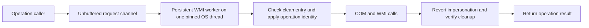

# WMI COM lifetime and identity ownership

## Overview and evidence

The Windows agent routes WMI process-creation calls through a persistent COM
worker. This is a lifecycle change intended to address the observed second
ambient connection failure under `make_token`. It does not change the operator
authentication contract: `make_token` stays ambient through cloaking; explicit
`-i` credentials remain a separate path and take precedence.

The lab's read-only probes established this comparison:

| Probe lifecycle | Impersonation between connections | Observed second connection |
| --- | --- | --- |
| COM initialized and uninitialized per attempt | Reverted and reapplied | Access denied |
| COM kept initialized | Held continuously | Success |
| COM kept initialized | Reverted and reapplied | Success |

The A → B → A probe also completed all three connections and class queries.
Target events confirmed authentication under Administrator and the second
account. The supplied export did not independently establish A2's remote
identity; reuse of an existing authenticated context can generate no new logon
event. Local token snapshots alone do not prove the account used remotely.

These results implicate the COM lifecycle. They do not prove a particular
Windows cache defect or establish that a dedicated thread is the only solution.
The read-only probe results do not establish end-to-end deployment acceptance.
Replay of the original remote back-to-back execution regression remains a
separate acceptance check.

## Architecture

`wmiComWorker` starts lazily on the first request. It owns one goroutine and one
native thread for the process lifetime. The thread initializes COM as MTA and
keeps that initialization alive between requests. MTA is a process-wide COM
apartment that can contain multiple threads; this worker is not a private MTA.

`wmiCreateProcess` submits work; `wmiCreateProcessChain` handles the individual
operation. Each operation creates and releases its WMI interfaces while COM
remains initialized. The captured ambient token is applied on the worker thread,
not inherited from the caller's thread. Explicit credentials use their existing
connection and proxy authentication path.

The COM lifetime is persistent; impersonation is temporary. Entry checks reject
an unexpected thread token. Ambient operations revert and verify their cleanup;
cleanup failure joins the operation error and raises the identity-boundary fault.

## Idle behavior and resource cost

The idle worker waits on a Go channel. It has no polling timer, heartbeat, or
application-level network keepalive. WMI requests cause authentication and
RPC/DCOM traffic. Keeping COM initialized can retain Windows-managed connection
state, so the worker's lack of polling is not a guarantee of complete process
network silence. The agent's beacon transport continues independently.

The direct idle cost is the goroutine, pinned native thread, and retained COM
resources. Worker startup failure is cached by `sync.Once`. There is currently
no explicit worker stop or restart path; the implementation relies on process
termination for final reclamation.

## Serialization and timeout limitations

All process-creation requests through this worker serialize across targets.
This is broader than the existing per-host deployment claim. A stalled Windows
call can occupy the worker and delay other hosts.

The current timeout bounds only waiting for a reply after submission. The
unbuffered channel send occurs before the timeout select, and worker startup
also precedes it. A caller waiting to submit to a busy worker is therefore not
covered by that timer. A nonpositive supplied wait is replaced by 30 seconds,
not treated as an already-expired deadline.

A reply timeout does not cancel an executing Windows call or prove that remote
work stopped. Do not describe this implementation as a fully bounded queue or
as enforcing an end-to-end deployment deadline.

## Local activation failure (HRESULT 0x800703FA, ERROR_KEY_DELETED)

Field deployments from an in-memory agent (a Go binary hosted by Windows
PowerShell through the loader chain, deployed over WinRM) observed
`CoCreateInstance(CLSID_WbemLocator)` failing with `0x800703FA`, before any
connection to the destination host. That HRESULT is
`HRESULT_FROM_WIN32(ERROR_KEY_DELETED)`: Win32 error 1018, an operation hit a
registry key marked for deletion during the local class resolution. It is not
a COM initialization failure and not an authentication failure — the in-process
activation never leaves the host, and the destination machine is not a factor.

One candidate mechanism — a hypothesis, not a confirmed cause: the per-user
half of the merged classes view tracks the calling token's profile, and a
process that keeps a user token without owning the profile lifetime — exactly
a WinRM-hosted, in-memory deployment — can observe a profile hive unloading
mid-process, leaving class-store keys in the delete-pending state. Two
properties of that state matter and are documented Windows behavior, not
assumptions:

- A deleted key is not removed until the last handle to it closes
  (`RegDeleteKey`), so the tombstone can outlive any bounded retry schedule:
  a failure persisting through the retries proves persistence, never a
  different cause.
- The HRESULT carries no information about which key was tombstoned — the
  per-user classes hive, a machine classes key, and a handle cached against a
  stale view all produce the same code. Only registry-level evidence
  separates them.

The production response is a bounded, local-only retry:

- `cocreateRetryDelay` (`agent-go/wmi_retry.go`) is the retry policy: exactly
  `0x800703FA` follows the `wmiCocreateRetryDelays` schedule
  (250 ms, 1 s, 3 s, then fail); every other HRESULT surfaces on the first
  attempt. The policy is platform-independent and host-tested.
- `cocreateWbemLocator` (`agent-go/wmi_windows.go`) applies the policy around
  the raw in-process activation (`wmiCocreateRaw`) used by the production
  `wmiCreateProcessChain`. Retries happen only before any network traffic, so
  nothing is ever resent to the destination. Exhausted retries still report
  the raw HRESULT.
- The read-only probe keeps recording the raw stage result; when it catches
  `0x800703FA` it annotates the stage so the operator knows the production
  chain retried it.

The retry is a targeted mitigation, not a root-cause proof. Identifying the
tombstoned key, its hive, and what marked it for deletion requires
registry-level evidence (Process Monitor or the
Microsoft-Windows-Kernel-Registry ETW provider), correlated with the process
identity and profile lifetime of the caller. A persistent failure calls for
that evidence collection — never for a different assumed cause or stronger
retries. The full procedure — facts-versus-hypotheses table, a read-only
reproducer, numbered diagnostic steps, and the decision table mapping
observations to conclusions — lives in
[wmi-key-deleted-diagnosis.md](wmi-key-deleted-diagnosis.md).

## Alternatives and decision

The dedicated worker closely follows the successful same-thread probe lifecycle
and gives COM and identity cleanup a clear owner. Its simplicity comes with
global serialization and a process-lifetime native thread.

| Alternative | Tradeoff and evidence |
| --- | --- |
| Hold COM initialization on an existing long-lived thread | Avoids a separate application worker but couples COM lifetime to that thread; not validated by these probes |
| Manage MTA support lifetime separately from operation threads | Windows provides `CoIncrementMTAUsage`; its documented lifetime guarantee does not prove it fixes this WMI failure or identity isolation |
| Pass explicit credentials for each connection | Succeeded in the comparison probe, but changes ambient authentication semantics; the current explicit WMI path selects NTLM |

COM does not inherently require a single serialized worker: an MTA can contain
multiple threads. Neither the alternatives nor concurrent execution have been
validated by the reported lab comparisons. This note records design options,
not an instruction to replace the current implementation.

## References

- Implementation: `agent-go/wmi_windows.go`; callers: `lateral_windows.go` and
  `wmi_loader_windows.go`.
- Diagnostics and test limits: [Go agent](go-agent.md#lateral-movement-__lateral__).
- Microsoft: [Processes, threads, and apartments](https://learn.microsoft.com/en-us/windows/win32/com/processes--threads--and-apartments).
- Microsoft: [CoIncrementMTAUsage](https://learn.microsoft.com/en-us/windows/win32/api/combaseapi/nf-combaseapi-coincrementmtausage).
